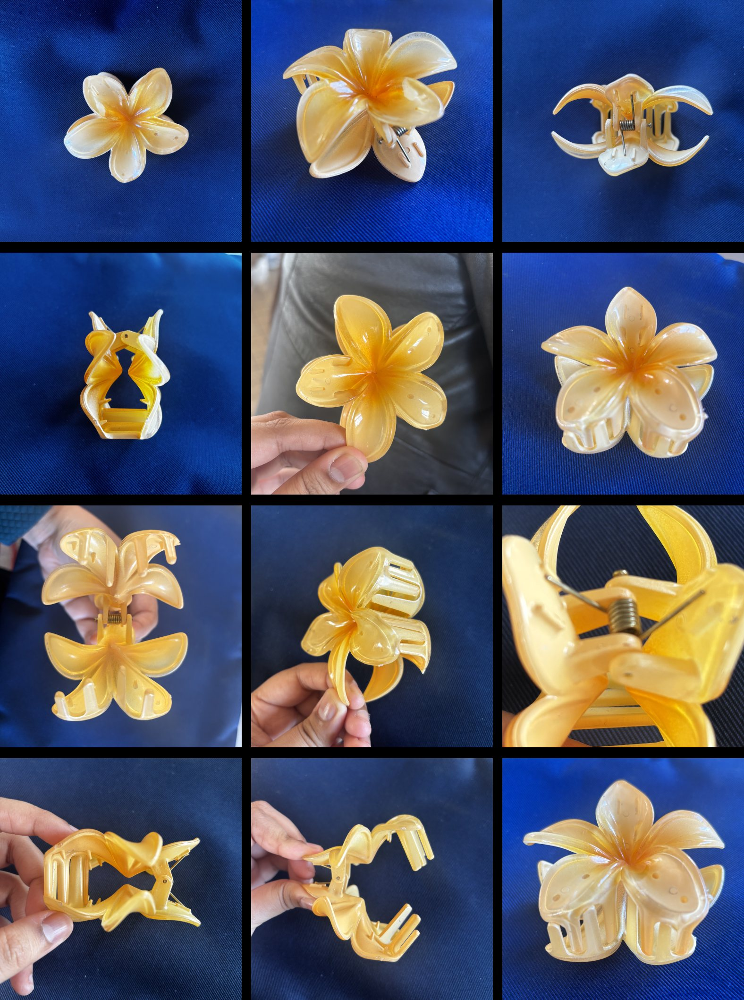
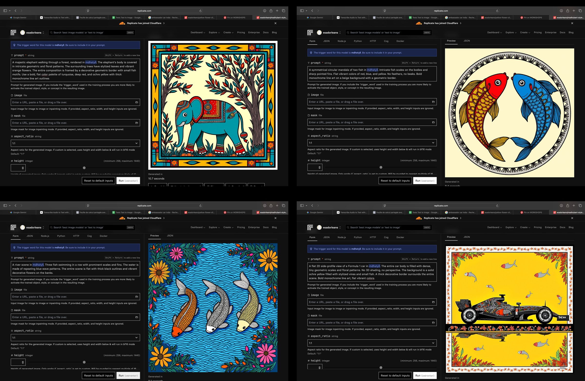
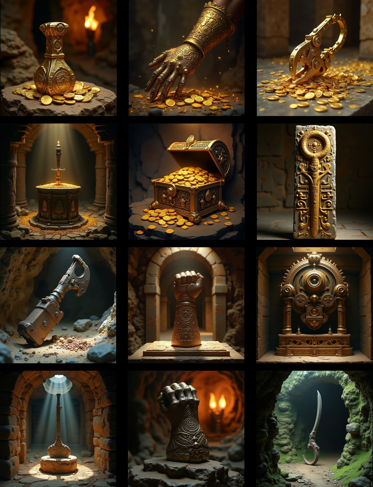

# Training my own image models: a LoRA workshop

My notes from a LoRA training workshop I took during my exchange semester at ESAD Orléans, France (spring 2026).

We started by writing prompts by hand and ended up training our own small models. I trained four LoRAs in total: one on an object I own, one on an art style from home, and two that worked together to build a fictional world for the final project.

I'm a UX designer, not an ML engineer, so this is written from that side. What did the model actually learn, where did it go wrong, and what did that teach me about my own inputs.

---

## The four parts

| | What I did | Trigger word |
|---|---|---|
| **[1. Prompting](./exercise1_prompting)** | Described two reference images in words and tried to get a model to rebuild them | none |
| **[2. Object LoRA](./exercise2_subject_lora)** | Trained a model on 12 photos of my yellow flower hair clip | `yellowflowerclip` |
| **[3. Style LoRA](./exercise3_style_lora)** | Trained a model on 15 Madhubani paintings | `mdhstyll` |
| **[4. Final project: Tumbbad](./final_project_tumbbad)** | Trained one LoRA on a world and one on objects, then used them together to design objects that belong in that world | `tmbbdwrld` `tmbbdobj` |

  
  
  

---

## What I took away

**The model fills every gap with its own average.** Whatever I didn't describe came back generic. Faces were the worst: I'd ask for a specific Victorian mountaineer and get a pretty, modern face.

**A LoRA learns what the photos show most, not what I meant.** Most of my hair clip photos showed the flower side. So the model learned "yellow flower" really well and mostly forgot that it's a claw clip with teeth and a spring.

**Style came through faster than an object.** The Madhubani colours, borders and framing showed up almost straight away. The fine line work and dense patterns are where it got lazy.

**Two LoRAs together gave the objects a home.** On their own, my Tumbbad objects looked like museum product shots on plain backgrounds. With the world LoRA added, they sat inside the cave, in the same light as everything else.

**My job moved from making the image to setting up the conditions for it.** Picking the photos, writing the captions and choosing the trigger words mattered more than any single prompt.

---

## Tools

- **Gemini (Nano Banana)** and **Flux 1.1** for the prompting exercise
- **Replicate** for training and running all four LoRAs (on our class account, `esadorleans`)

## A few words we used in class

- **LoRA (Low Rank Adaptation):** a small add on trained on top of a big image model, so it can learn one new subject or style from a handful of images without retraining the whole thing.
- **Trigger word:** a made up word attached to the training images. Putting it in a prompt switches the LoRA on.
- **Semantic gap:** the distance between what I see in an image and what I can actually put into words.
- **Facture:** the surface quality of an image: its texture, grain, brushwork, how it feels made.
- **Latent space:** the space of visual patterns the model has learned, where it "looks" when it makes an image.

---

## Try the Tumbbad models

- [World LoRA on Replicate](https://replicate.com/esadorleans/tumbbad-gold-world)
- [Object LoRA on Replicate](https://replicate.com/esadorleans/tumbbad-artifacts-lora)

## Credits

- The Madhubani paintings in the style dataset are by other artists (some carry their signatures). I used them only to learn for this class exercise and don't claim them as mine.
- *Tumbbad* (2018) is a film directed by Rahi Anil Barve. The poster and reference images belong to its makers.
- The pool reference in Exercise 1 is David Hockney's *Portrait of an Artist (Pool with Two Figures)*, 1972.

---

Anubhuti Raj · UX Designer · [Portfolio](https://rajanubhuti.github.io/portfolio/) · [LinkedIn](https://www.linkedin.com/in/anubhutiraj-ux)
