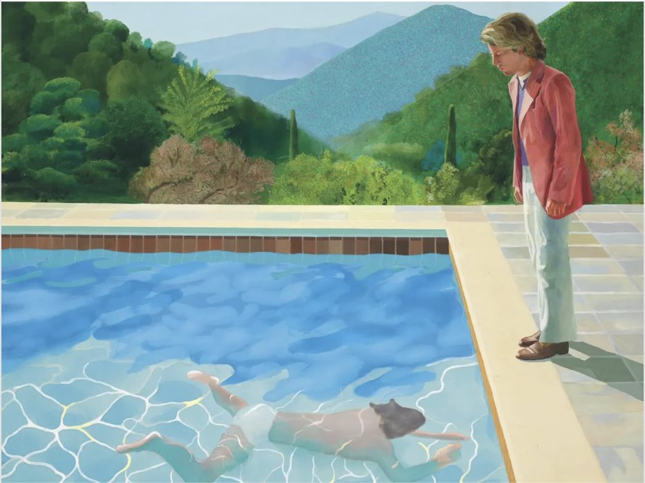
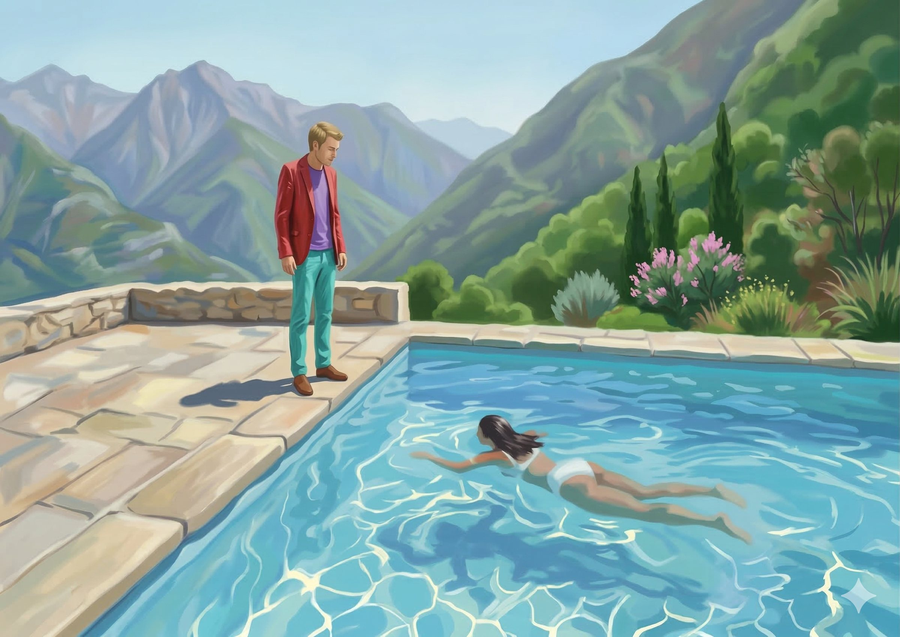
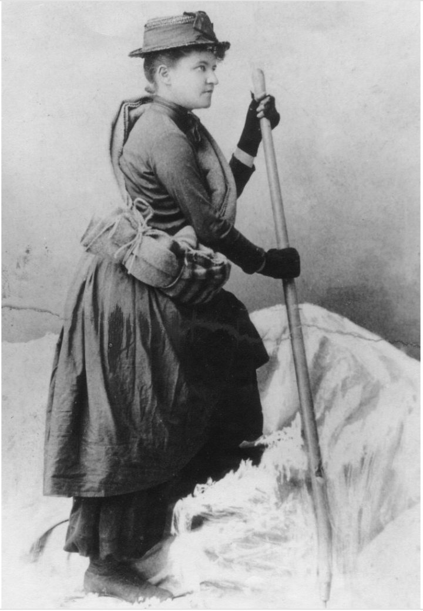
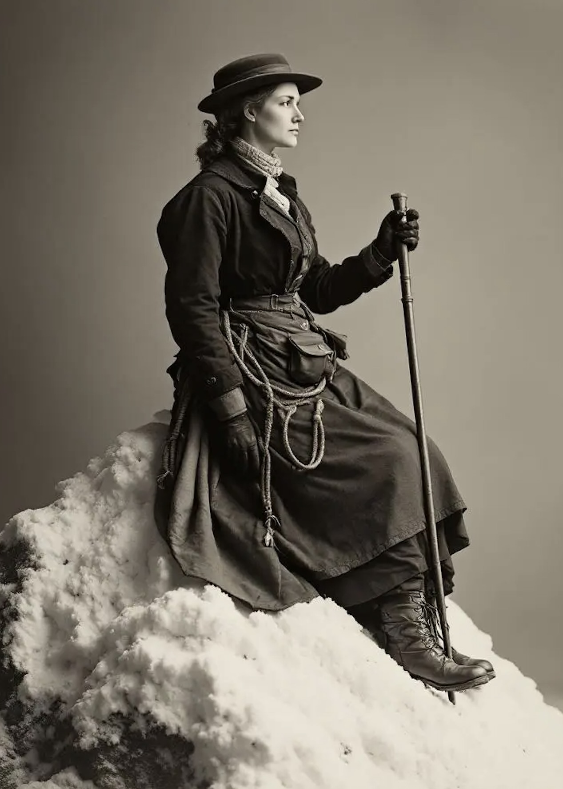

# Exercise 1: Turning an image into words

[← Back to the overview](../README.md)

Before training anything, we had to get good at describing. The exercise: take a reference image, write it down as precisely as possible, give only that text to an image model, and see how close it gets.

It sounds easy. It isn't. You find out very quickly how much of an image you take in without ever putting it into words.

## How I broke the images down

For each reference I went through the same checklist before writing anything:

- composition and framing
- who is in it, their pose and where they are facing
- clothes and objects
- lighting
- materials and textures
- colour palette
- medium (painting, photo, print)
- mood
- depth and perspective

Then I turned those notes into one long prompt.

---

## Image 1: the pool painting

Reference: David Hockney, *Portrait of an Artist (Pool with Two Figures)*, 1972.

**My prompt**

> Generate a vivid acrylic painting. Foreground: beige and gray stone terrace with a clear pool. Submerged and blurred underwater, a dark haired figure in white swimwear swims toward the bottom center. On the terrace edge stands a blond man in a red blazer, purple t shirt, turquoise pants, and brown shoes, looking down at the swimmer with a shadow to his right. Background: two crossing green mountains, the right one is lush with varied green and blurry brown trees. Far distance: three mountains fading to blue gray under a blue sky.

| Reference | What the model made |
|---|---|
|  |  |

**What it got right:** the painted look, the man's outfit down to the colours, the stone terrace and the layered mountains.

**What it missed:** the swimmer. I wrote "submerged and blurred underwater" and it put her on the surface, swimming sideways instead of down. The man moved from the front edge to the back of the pool and became small. In the original he and the swimmer are close and the tension between them is the whole painting. In mine they are just two people in the same scene.

---

## Image 2: the Victorian mountaineer

**My prompt**

> Authentic 1890s albumen print of a female Victorian mountaineer. She is standing in profile on a jagged, icy snow mound. She wears a structured wool bodice, a heavy layered floor length trekking skirt, dark gloves, and a small felt mountain hat. A long, weathered wooden alpenstock staff with a metal ferrule tip is gripped firmly in her hand. Strapped to her lower back is a period accurate gear bundle with hemp ropes and canvas bedroll. The image features heavy silver gelatin grain, slight motion blur at the edges, high contrast sepia toned blacks, and authentic chemical weathering. 5:7 aspect ratio.

| Reference | What the model made |
|---|---|
|  |  |

**What it got right:** the sepia tone, the clothes, the hat, the staff and the ropes. Every object I named showed up.

**What it missed:** she's perched on the snow instead of standing, and her face is a smooth, modern, pretty face instead of a real person from the 1890s. The "heavy grain" and "chemical weathering" came out far too clean. It looks like a new photo with a vintage filter, not an old print.

---

## Tools

- Gemini (Nano Banana)
- Flux 1.1

## What I learned

- Objects and colours are easy. Pose, direction and the relationship between people are hard, even when I describe them clearly.
- When the model isn't sure, it falls back to its average. That's why the mountaineer got a stock photo face.
- Describing the whole image isn't enough. Control comes from the small details, and even then some things (a gaze, a tension) barely survive the trip into words.

The real challenge wasn't seeing the image. It was translating what I saw into something the model could use.
