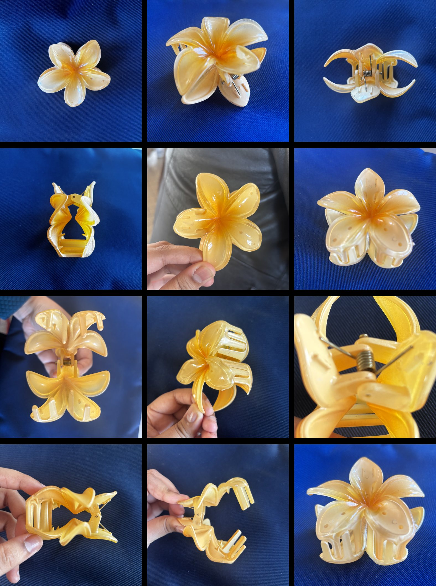
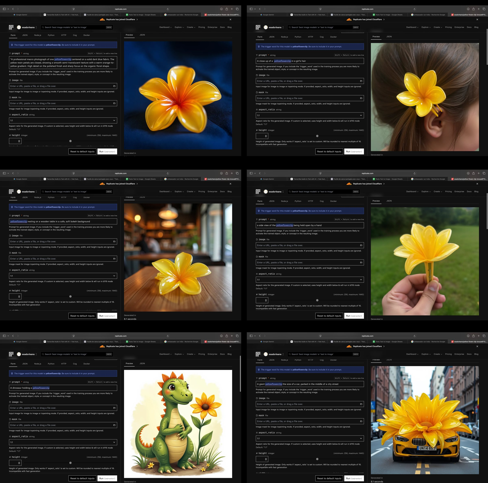

# Exercise 2: Teaching a model my hair clip

[← Back to the overview](../README.md)

Prompting only gets you what the model already knows. To get something it has never seen, you have to teach it. So for this exercise I trained a LoRA on a real object I own: my yellow flower claw clip.

I picked it because it has a clear shape and colour, a glossy plastic finish, and small mechanical details (the teeth and the spring) that would show whether the model actually understood it.

## The dataset

12 photos, mostly against the same dark blue fabric so the clip stands out:

- top, side, front and underneath views
- a few close ups of the spring and teeth
- a few in my hand, opened and closed, so it has some sense of size

**Trigger word:** `yellowflowerclip`

Each photo got a short text caption describing the clip, its angle and what's around it. These captions are what the model links to the images, so they matter as much as the photos.

## Testing it

I trained the LoRA on Replicate and then tried it in different situations, from easy to deliberately weird.

| Prompt (short version) | How it went |
|---|---|
| Macro product photo on dark blue fabric | Very close to my photos. Colour, gloss and petal shape all right. |
| Close up in a girl's hair | Looks great as a flower, but the clip part is hidden. It sits in the hair like a real flower would. |
| Resting on a wooden table in a cafe | Good. Right colour and finish, believable size. |
| Side view, held open by a hand | It turned into a real lily on a stem. No clip mechanism at all. |
| A dinosaur holding one (cartoon) | It drew a sunflower. In an illustration style the LoRA was almost completely lost. |
| A giant one the size of a car on a city street | It merged the flower into a yellow car. Funny, but it shows the model has no real idea of the clip's scale. |

## What went wrong, and why

**It learned "yellow flower," not "claw clip."** Most of my photos show the pretty flower side. The teeth and spring only appear in a few. So the model held on to the flower and dropped the clip.

**Scale was confusing.** Lots of my shots are close ups that fill the frame, and only a few show it in a hand. With so little to compare it against, the model didn't know how big the clip is.

**Style changes broke it.** All my photos are realistic photos. As soon as I asked for a cartoon, the LoRA had nothing to hold on to.

## If I did it again

- More photos that show the clip *as a clip*: open, closed, gripping hair from behind.
- More shots with something for scale (a hand, a comb, a table) and less of the plain fabric.
- Captions that name the parts ("claw teeth," "metal spring") so the model links those words to them.

The model learns from what the dataset actually shows and what the captions actually say. Not from what I had in my head when I took the photos.
