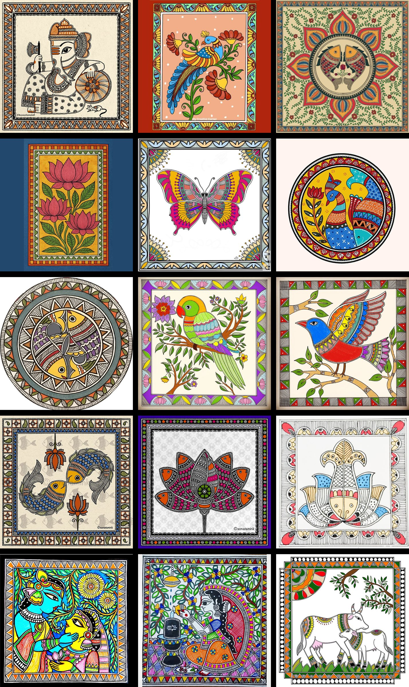
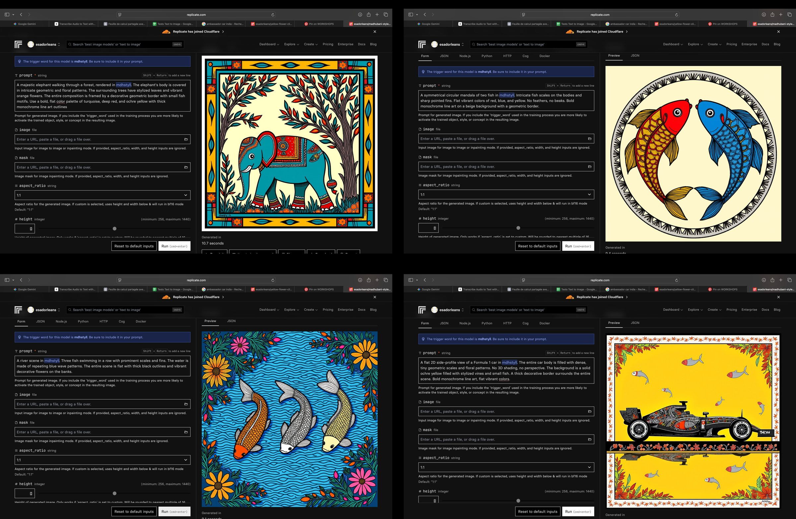

# Exercise 3: Teaching a model Madhubani

[← Back to the overview](../README.md)

After an object, we trained a style. I chose Madhubani, the folk painting tradition from Mithila in Bihar, my home state. It felt like the natural pick, and it meant I could tell quickly when the model got something wrong.

A style is different from an object. There's no single shape to learn. It's a set of rules:

- bold black outlines
- flat, bright colours
- every empty space filled with lines, dots and patterns
- decorative borders framing the scene
- recurring motifs: fish, birds, lotus, peacocks

## The dataset

15 Madhubani paintings, chosen to be consistent rather than varied: mostly square, mostly with borders, mostly animal and flower subjects.

*These paintings are by other artists (several are signed). I used them only to learn for this class exercise.*

**Trigger word:** `mdhstyll`

The captions described the style rather than the subject: fill patterns, line weights, border designs, how dense the decoration is.

## Results

I tested it on classic Madhubani subjects and on one that has nothing to do with it: a Formula 1 car.

| Prompt (short version) | How it went |
|---|---|
| An elephant walking through a forest | The best one. Patterned elephant, stylised trees, a proper double border. |
| A circular mandala of two fish | Strong. Circular frame, scales filled with pattern, very close to the dataset. |
| Three fish swimming in a river | Colourful and nice, but it drifted towards a generic koi illustration. Less Madhubani, more stock art. |
| A flat side view of an F1 car | The border, fish and yellow background are right. The car itself still looks like a 3D render with a pattern painted on top. |

## What I noticed

- **Colour, borders and composition came through first.** They're big and repeated in every training image, so the model picked them up quickly.
- **Line work is the weak spot.** Real Madhubani has very fine, careful lines. The model's lines get blurry or simplified, especially in busy areas.
- **It copies the look, not the meaning.** It knows fish and borders go together, but not why. It doesn't know what a motif means or where it belongs.
- **Unusual subjects are the real test.** The F1 car showed where the style stops: it can decorate an object, but it can't redraw it the Madhubani way.

Training a style is less about showing the model pictures and more about giving it a consistent set of visual rules it can repeat.
