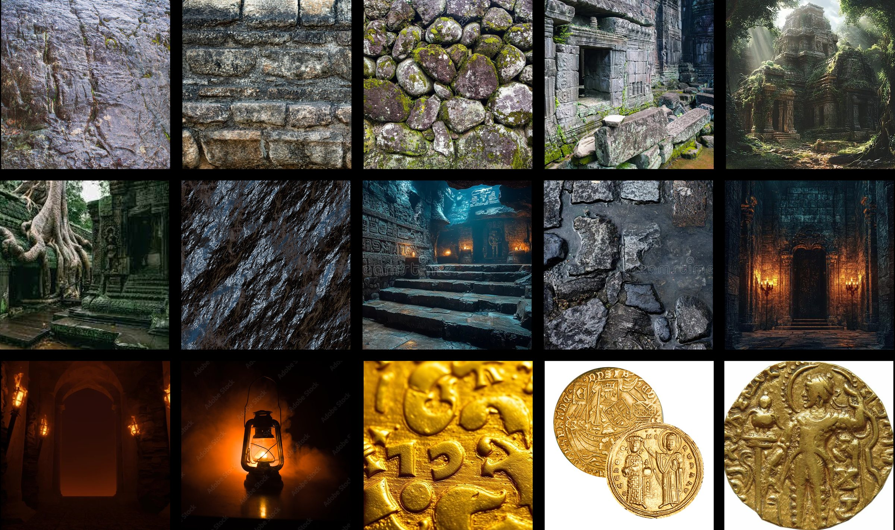
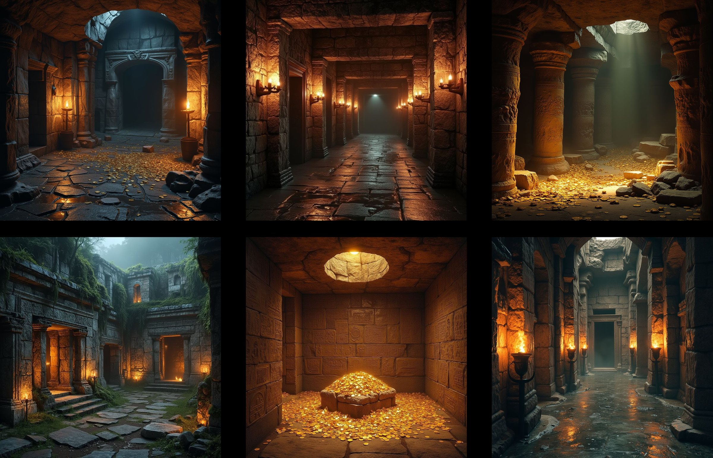
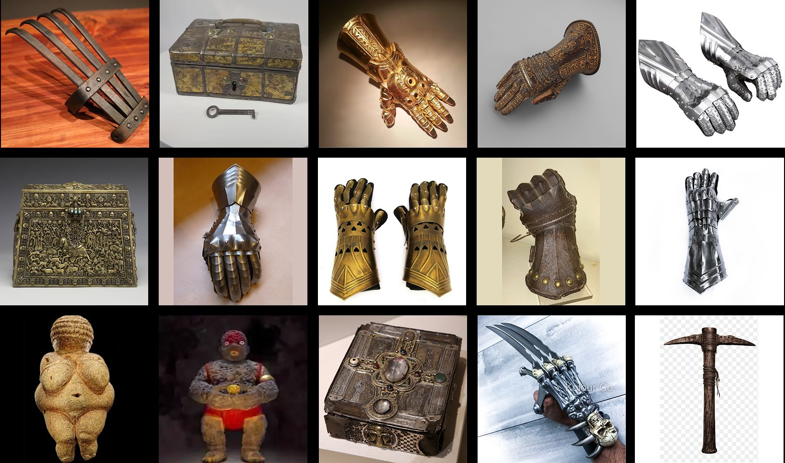
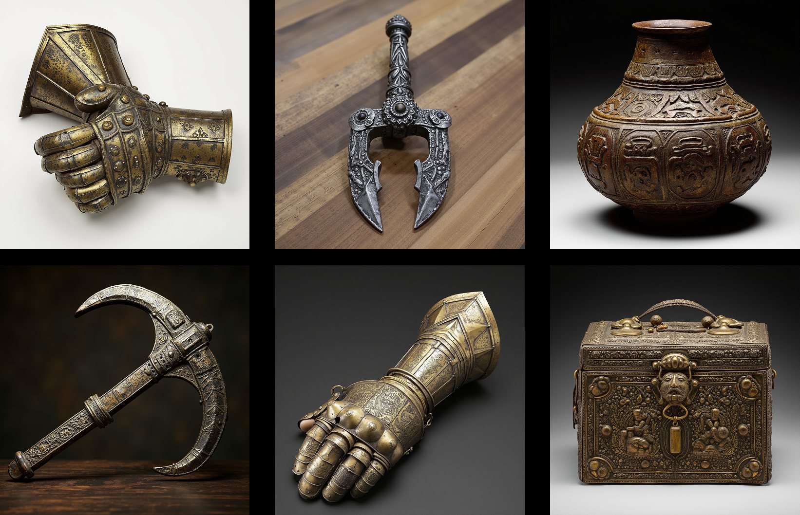
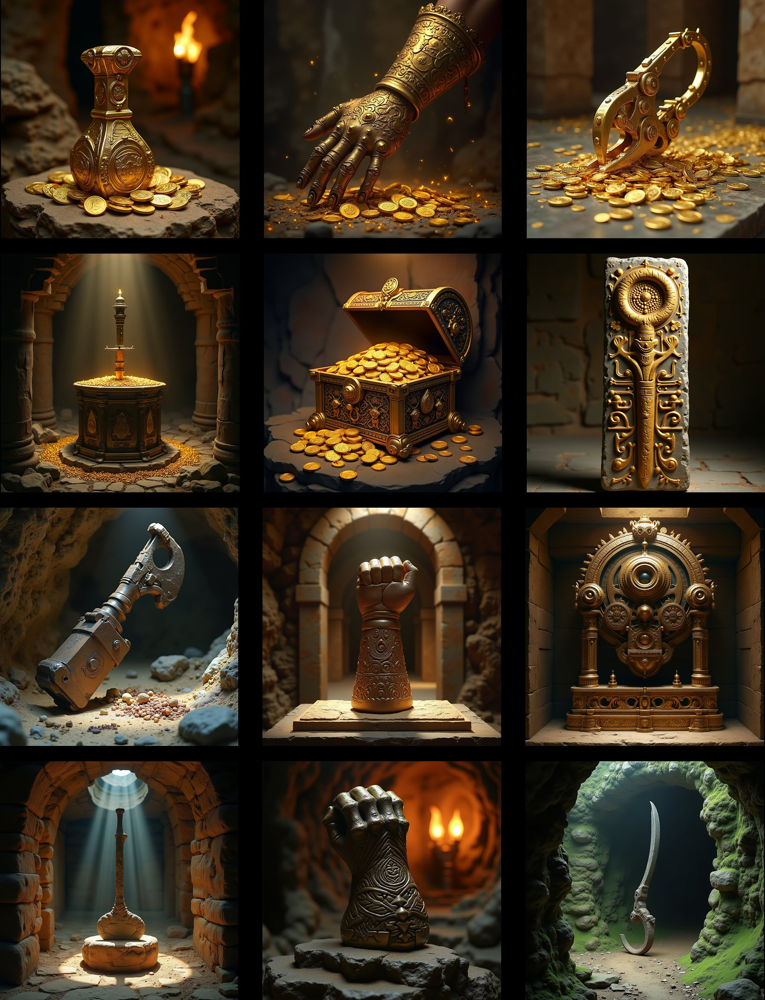

# Final project: Designing objects for the world of Tumbbad

[← Back to the overview](../README.md)

For the final project I wanted to use LoRAs for something closer to design than to making pretty pictures. The question I set myself:

**Can AI help design objects that feel like they belong to a specific fictional world?**

## Why Tumbbad

*Tumbbad* (2018, directed by Rahi Anil Barve) is an Indian folk horror film. The family in it keeps going down into a hidden, wet, underground space to steal gold coins from a cursed creature, and each trip is more dangerous than the last.

*Poster belongs to the film's makers.*

It's a great world to design for because it comes with built in constraints:

- **Material:** mud, wet stone, rot, and gold everywhere
- **Light:** almost dark, with small warm sources like torches
- **Space:** tight, enclosed, claustrophobic
- **Story:** people need to go in, grab gold and get out without being caught

That last point is the important one for design. If you have to collect gold from something that wants to grab you, you need tools. What would those tools look like?

## The plan: two LoRAs

Instead of one model that knows everything, I trained two:

1. **A world LoRA** that learns the environment: the caves, stone, light and wetness
2. **An object LoRA** that learns the kind of things that could exist there: gauntlets, chests, tools
3. Then I **use both together**, so the objects come out already sitting inside the world

---

## Part 1: The world LoRA

**Trigger word:** `tmbbdwrld`

The dataset is underground caves and temple like corridors, eroded and wet stone, dim light with strong warm highlights, and gold coins. I chose images that agree with each other on material, light and mood, so the model learns one consistent world rather than "caves in general."

**Test prompts**

- `tmbbdwrld dark underground temple chamber with wet stone floor and scattered gold coins, torch lighting`
- `tmbbdwrld ancient temple corridor carved in stone, dim torch lights reflecting on wet floor`
- `tmbbdwrld underground cave temple filled with gold coins and stone pillars, dark cinematic lighting`

This worked well. The low light, warm torches, wet reflective floors and scattered gold all came through. One image drifted outside into a mossy courtyard, which isn't really Tumbbad, but the rest felt like the same place.

---

## Part 2: The object LoRA

**Trigger word:** `tmbbdobj`

The dataset is protective gloves and gauntlets, chests and containers, and old metal tools, with lots of engraving, wear and tarnish. I picked them for how they'd be used, what they're made of and how clearly you can read their shape.

**Test prompts**

- `tmbbdobj ornate medieval armored gauntlet artifact`
- `tmbbdobj ancient mechanical claw tool made of metal`
- `tmbbdobj ritual artifact container with carved engravings`

The model understood the types of objects and the worn brass and iron look. But every result looks like a museum product photo on a plain background. They're nice objects, but they don't belong anywhere yet.

---

## Part 3: Both together

Using both trigger words in the same prompt:

- `ancient gold extraction gauntlet artifact, tmbbdobj, tmbbdwrld, carved stone and gold coins, torch lit cave`
- `ornate armored gauntlet designed to collect cursed gold coins, tmbbdobj, tmbbdwrld, temple stone and gold`
- `ancient container for cursed gold coins, tmbbdobj, tmbbdwrld, carved temple stone chest`

This is where it came together. The objects now sit on stone, in torchlight, surrounded by coins, and look like they've been there for a hundred years.

The **gold gauntlet** (top middle) is my favourite. It reads like a real answer to the story: a glove for scooping up coins so your bare hand never touches the gold, or whatever is guarding it.

Other objects that came out: a gold flask, a mechanical claw for picking up coins, a chest overflowing with gold, carved stone tablets and shrine like pieces.

## What didn't work

- **Some objects look cool but make no sense.** I can't always tell how you'd hold or use them.
- **Too much gold.** Gold dominated almost everything, so the objects started to look alike.
- **Some drift.** One image (bottom right) ended up in a green mossy cave with a sickle, which doesn't match the world.

I only had time for one round of training, so this is a first pass. Next time I'd add more variety to the object dataset (less gold, more rope, leather and wood) and write more precise captions about function.

## What it taught me

In this project I didn't draw a single object. My design work was choosing the images, deciding what the world's rules are, writing the captions and steering the prompts.

The model doesn't imagine anything on its own. It recombines what it has learned. So the designer's job becomes setting up the conditions where a useful result can show up, and then knowing which result is actually good.

## Try the models

- [World LoRA on Replicate](https://replicate.com/esadorleans/tumbbad-gold-world)
- [Object LoRA on Replicate](https://replicate.com/esadorleans/tumbbad-artifacts-lora)
